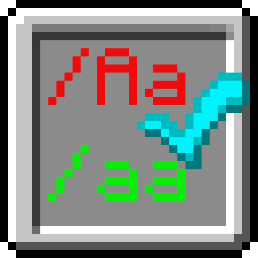

<!-- PROJECT BADGES -->

![Version][version-badge]
[![Stars][stars-badge]][stars-url]
[![License][license-badge]][license-url]

<!-- PROJECT LOGO -->
 

  
  <h3>IgnoreCase</h3>
  

    A plugin that automatically corrects the case of commands!

[Contact to me][author-discord] · [Report a bug][issues-url] · [Request a feature][issues-url]

  

<!-- ABOUT THE PROJECT -->

### Overview

- **What it does**
  - If the case of a command is incorrect, it is automatically corrected.
    - `/Tp someone` => `/tp someone`
    - `/SAY hello` => `/say hello`

---

### Installation & Requirements

- **Server**
  - [axolotl-pm/PocketMine-MP](https://github.com/axolotl-pm/PocketMine-MP) `5.51` or higher (`plugin.yml` `api: [5.51.0]`),
    which uses BedrockProtocol 64 (Bedrock `1.26.60`).
  - PHP `8.4` or higher.
- **Installation**
  - Download `IgnoreCase.phar` from [GitHub Releases][releases-url] and place it into your server's `plugins` directory.
  - Restart the server; the plugin will load automatically according to `plugin.yml`.
- **Old versions**
  - The version for the original [pmmp/PocketMine-MP](https://github.com/pmmp/PocketMine-MP) `5.x` (PHP 8.1+, distributed
    through Poggit) is kept on the [`legacy/pmmp-5.44`](https://github.com/presentkim-pm/IgnoreCase/tree/legacy/pmmp-5.44) branch.
- **Development**
  - `composer install` then `composer test` runs the PHPUnit tests.

---

### License

Distributed under the **LGPL 3.0**. See [LICENSE][license-url] for more information

-----

[author-discord]: https://discordapp.com/users/345772340279508993

[version-badge]: https://img.shields.io/github/v/release/presentkim-pm/IgnoreCase?display_name=tag&style=for-the-badge&label=VERSION

[release-badge]: https://img.shields.io/github/downloads/presentkim-pm/IgnoreCase/total?style=for-the-badge&label=GITHUB%20

[stars-badge]: https://img.shields.io/github/stars/presentkim-pm/IgnoreCase.svg?style=for-the-badge

[license-badge]: https://img.shields.io/github/license/presentkim-pm/IgnoreCase.svg?style=for-the-badge

[stars-url]: https://github.com/presentkim-pm/IgnoreCase/stargazers

[releases-url]: https://github.com/presentkim-pm/IgnoreCase/releases

[issues-url]: https://github.com/presentkim-pm/IgnoreCase/issues

[license-url]: https://github.com/presentkim-pm/IgnoreCase/blob/main/LICENSE

[project-icon]: https://raw.githubusercontent.com/presentkim-pm/IgnoreCase/main/assets/icon.png
